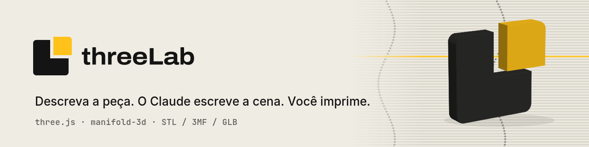
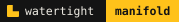
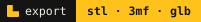

<p align="center">
  <picture>
    <source media="(prefers-color-scheme: dark)" srcset="brand/mockups/threelab-readme-header-escuro.png">
    
  </picture>
</p>

<p align="center">
  <a href="https://github.com/elalish/manifold"></a>
  <a href="#exportar"></a>
  <a href="#a-interface"></a>
</p>

# threeLab

Modelos 3D por código. Descreva o que quer, cole o código que a IA escreveu, confira as medidas e exporte para
web ou impressão 3D. Cada modelo é um arquivo JavaScript sobre [three.js](https://threejs.org) e
[manifold-3d](https://github.com/elalish/manifold) (booleanas que sempre geram sólidos fechados).

Tudo roda no navegador. O app não envia nada a servidores.

## Começar

Requer Node 18 ou superior.

```bash
npm install
npm run dev        # abre em http://localhost:5199
```

## A interface

**Barra lateral**

| Bloco | O que faz |
|---|---|
| **Novo modelo com IA** | Abre o fluxo descrever → copiar prompt → colar resposta (veja abaixo). |
| **Minhas criações** | Modelos que você colou. Ficam salvos neste navegador. O **×** exclui. |
| **Exemplos** | Cenas de `scenes/`. Clique para abrir. |
| **Modelo atual** | Título, descrição e medidas: L × P × A em mm, triângulos, peças, volume, massa em PLA maciço, se a malha está fechada e se cabe numa mesa de 256 mm. |
| **Ajustar com IA** | Gera um prompt com o código atual e o que você quer mudar. |
| **Exportar** | `.glb`, `.gltf`, `.usdz`, `.stl`, `.3mf`, `.obj`, `.ply`, mais **Copiar código para site**. |

**Palco**

- **Parâmetros** (canto superior direito): um controle por parâmetro da cena. Número vira slider, `#rrggbb` vira seletor de cor, texto vira campo, lista vira menu. **Restaurar padrões** volta aos valores originais.
- **Barra de ferramentas** (embaixo):
  - Vistas: **Iso**, **Frente**, **Lado**, **Topo**.
  - **Malha** mostra o wireframe, **Medidas** desenha a caixa de dimensões, **Corte** abre o modelo ao meio (x = 0) para ver o interior, **Girar** gira sozinho, **PNG** salva a imagem. O seletor ao lado escolhe **Com selo** (padrão, *made with threeLab* no canto inferior direito) ou **Sem selo**.
- Os parâmetros e a câmera de cada cena são lembrados enquanto a aba estiver aberta.

No fim da barra lateral, o selo **código aberto · github** abre o repositório do projeto.

Convenção de medidas: 1 unidade = 1 mm, eixo Y para cima, chão em y = 0.

## Criar um modelo com IA

1. Clique em **Novo modelo com IA** e descreva o que quer. Ex.: *suporte de celular com 70 mm de largura e o nome "Ana" em relevo*.
2. Escolha o objetivo: **Visualização / site (GLB)**, **Impressão 3D (várias cores)** ou **Impressão 3D em resina (uma cor)**.
3. Clique em **Copiar prompt** e cole na IA que preferir (ChatGPT, Claude, Gemini…). O prompt já inclui a referência da biblioteca (`src/prompt/reference.md`) e o formato esperado. **ver prompt** mostra o texto antes de copiar.
4. Cole a resposta da IA no passo 3, com ou sem as cercas \`\`\`, e clique em **Carregar modelo**.

O threeLab compila o código no navegador, valida, salva em **Minhas criações** e abre o modelo com os controles de parâmetros.

- **Deu erro?** O app mostra a mensagem e oferece **Copiar erro para a IA corrigir**. Nada é salvo enquanto o código falha.
- **Quer mudar algo?** Use **Ajustar com IA**. Funciona também nos exemplos.
- **Segurança:** o código colado é executado na página. Cole só respostas de IA que você mesmo pediu.

## Exportar

- **Site:** `.glb` (o melhor para web), `.gltf`, `.usdz` (AR no iPhone). **Copiar código para site** copia um snippet `<model-viewer>` e baixa o GLB.
- **Impressão:** `.3mf` (uma cor por peça) e `.stl` (uma cor).
- **Outros:** `.obj`, `.ply`.

GLB, glTF e USDZ saem em metros. STL, 3MF, OBJ e PLY saem em mm. STL e 3MF usam Z para cima.

## Feito com threeLab

A atribuição é opcional. O app põe o selo nos PNGs por padrão e o seletor ao lado do botão **PNG** o desliga. Se quiser mostrar de onde o modelo veio no seu repositório, copie `brand/badges/made-with-threelab.svg` para o seu repositório e use:

```markdown
[](URL-DO-REPOSITORIO-THREELAB)
```

Em `brand/badges/` há também `watertight-manifold`, `export-stl-3mf-glb` e `unit-1mm`.

## Formato de uma cena

```js
import { box, cylinder, subtract, group } from '../src/lib/index.js';

export const meta = { title: 'Suporte', description: 'Uma frase sobre o modelo.' };

export const params = {
  width: { value: 70, min: 40, max: 120, step: 1, label: 'Largura (mm)' },
  color: { value: '#3e63dd', label: 'Cor' },
};

export default function build(p) {
  return group([ /* objetos 3D */ ]);
}
```

A biblioteca completa (sólidos, extrusão, torno, texto, booleanas, oco, furos) está em `src/lib/index.js`
e resumida em `src/prompt/reference.md`.

## Linha de comando

Para trabalhar com arquivos em `scenes/` em vez de colar código:

```bash
npm run list                                   # lista as cenas
npm run new caneca "Caneca"                    # cria scenes/caneca.js
npm run check porta-copos                      # dimensões, volume, massa, peças fechadas?
npm run walls vaso-espiral                   # espessura mínima das paredes
npm run export porta-copos -- --formats all --set label=Ana
```

A saída vai para `exports/<nome>/`. Use `--printer 256x256x256` para trocar a mesa da impressora.

## Com o Claude Code

Abra a pasta no Claude Code e peça direto: *cria um suporte de celular com o meu nome*, *exporta o foguete para o meu site*.
O `CLAUDE.md` ensina o Claude a escrever a cena, conferir no navegador e exportar.

## Estrutura

```
scenes/        modelos de exemplo (um arquivo por modelo)
src/lib/       biblioteca de modelagem
src/viewer/    interface (visualizador, diálogo de criação)
src/prompt/    referência e prompts para a IA
src/export/    exportadores e análise de malha
cli/           comandos de terminal
brand/         badges, header do README e guia da identidade visual
```

Fontes: Archivo e JetBrains Mono (OFL), servidas localmente.

## Contribuir

Veja o [CONTRIBUTING.md](CONTRIBUTING.md), o [ROADMAP.md](ROADMAP.md) e o [CHANGELOG.md](CHANGELOG.md).
Vulnerabilidades: [SECURITY.md](SECURITY.md). Ao participar, você concorda com o [Código de Conduta](CODE_OF_CONDUCT.md).

## Licença

[MIT](LICENSE). three.js (MIT), manifold-3d (Apache-2.0), Archivo e JetBrains Mono (OFL) mantêm suas próprias licenças.
